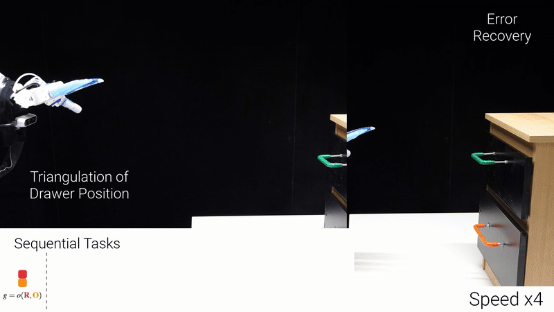

# Active InterCONnect (AICON)

[](https://github.com/pylint-dev/pylint)
[](https://github.com/PyCQA/flake8.git)
[](https://www.python.org/downloads/)


AICON is a framework for building robotic systems that estimate states and select actions through dynamically
composed gradient descent. Recursive estimators are linked by *active interconnections*; goals are cost functions on
estimated quantities, and their gradients flow back through the graph to the actions. Where several goals compete,
their gradients are ordered by magnitude and projected into each other's nullspace, so subgoals emerge from the
structure of the problem instead of from a planner.

This is the implementation for "No Plan but Everything Under Control: Robustly Solving Sequential Tasks with
Dynamically Composed Gradient Descent" (Mengers & Brock, ICRA 2025). Videos and results:
[https://www.tu.berlin/robotics/papers/noplan](https://www.tu.berlin/robotics/papers/noplan)



## Key concepts

- **Recursive estimators** maintain a differentiable state estimate (with uncertainty) and encode regularities in
  sensor inputs, actions and time.
- **Active interconnections** are implicit differentiable functions relating sensed, estimated and actuated
  quantities. Information flows through them in both directions, and which of them matter changes with the state.
- **Gradient-based action selection** follows the steepest goal gradient. Conflicting gradients are resolved by
  nullspace projection and, if progress stalls, by an exploratory escape from the conflict.

## Repository layout

| Path | Contents |
|---|---|
| `aicon_base/` | The framework: component base classes (sensors, estimators, actions, goals), active interconnections, derivative bookkeeping and gradient projection, inference helpers (EKF), SE(3) math, the sequential middleware and the network-graph visualization |
| `aicon_ros/` | ROS 2 middleware (ament package with the message definitions and `aicon_ros_python_wrapping`): every component runs in its own process and they communicate over topics |
| `aicon_real_robots/` | Reusable components for a Franka Panda with wrist F/T sensor, RBO hand and RealSense cameras (require ROS 2) |
| `examples/` | Example systems built with AICON, see below; the names of simulation-only examples end in `_sim` |
| `docs/` | Coding standards, class diagrams and badges |
| `tests/` | Unit tests and short end-to-end runs of the examples |

## Examples

| Example | Needs | Run (from the repository root) |
|---|---|---|
| `examples/blocksworld` – sequential stacking tasks without a planner | Python only | `python -m examples.blocksworld.run_experiment` |
| `examples/nav_2d` – reach a target known only through bearing measurements, around obstacles | Python only | `python -m examples.nav_2d.run_experiment` |
| `examples/pusht` – push a T-shaped block into a goal pose in the [gym-pusht](https://github.com/huggingface/gym-pusht) simulation | Python only | `python -m examples.pusht.run_experiment --episodes 3` |
| `examples/drawer_sim` – find, grasp and open a drawer in [robosuite](https://robosuite.ai); a step-by-step tutorial ([TUTORIAL.md](examples/drawer_sim/TUTORIAL.md)) and an extended version with a wrist camera that triangulates the handle | Python only | `python -m examples.drawer_sim.run_experiment [--variant extended] [--render]` |
| `examples/object_pushing_real` – push objects to a goal pose with a Panda and an in-hand RGB-D camera | ROS 2, robot, camera, F/T sensor | see [Real-robot examples](#real-robot-examples) |
| `examples/drawer_manipulation` – open drawers with a Panda and an RBO hand | ROS 2, robot, hand, camera, F/T sensor | see [Real-robot examples](#real-robot-examples) |

Every runner has `--help`. Figures and frames are written to `outputs/`.

## Building your own system

The drawer tutorial ([examples/drawer_sim/TUTORIAL.md](examples/drawer_sim/TUTORIAL.md)) builds a complete system step
by step, and the PushT example (`examples/pusht`) is a compact template. A system consists of

- **sensors** (`SensorComponent`): implement `obtain_measurements`, which writes measured quantities,
- **estimators** (`EstimationComponent`): implement `initialize_quantities` and `define_estimation_function_f`, a
  differentiable update of the estimated quantities that uses the connections' functions,
- **actions** (`ActionComponent`): implement `determine_new_actions`, typically a step along
  `get_steepest_plus_projected(...)`, the combined goal gradient on the action quantity, and `send_action_values`,
- **active interconnections** (`ActiveInterconnection`): implement `define_implicit_connection_function`, a
  differentiable relation between quantities (e.g. a measurement model returning `measured - predicted`),
- **goals** (`Goal`): costs on estimated quantities, attached to the estimator that owns them.

Components only communicate through the quantities of shared connections, referred to by name. An experiment
specification returns builder functions for all of them:

```python
def get_building_functions():
    connections = {"PusherPointMeasurement": lambda device, dtype, mockbuild: PusherPointMeasurement(
        "PusherPointMeasurement", device=device, dtype=dtype, mockbuild=mockbuild), ...}
    components = {
        "PusherSensor": lambda mockbuild: PusherSensor(
            "PusherSensor", connections={k: connections[k] for k in ("PusherPointMeasurement",)},
            mockbuild=mockbuild),
        "ObjectEstimator": lambda mockbuild: ObjectEstimatorSim(
            "ObjectEstimator", connections={k: connections[k] for k in (...)},
            goals={"Push2Goal": lambda device, dtype, mockbuild=False: Push2GoalSim(is_active=True, dtype=dtype,
                                                                                  device=device)},
            mockbuild=mockbuild),
        ...}
    return components, connections, frame_rates
```

which are run either in one process,

```python
components = build_components(component_builders)
for i in range(n_ticks):
    components = run_component_sequence(components, torch.tensor(i * 0.1))
```

or, with ROS 2, one process per component (`build_components_with_ros_middleware` in `aicon_ros`).

**Linter (coming soon).** AICONLS, a linter and language server for AICON by Ole Liebich, checks the code of a system
against a `spec.yaml` that describes its graph: the components with their quantities, the connections between them and
the goals. It catches, for example, quantities with the wrong shape and connections whose gradients vanish. Each example
directory already has its `spec.yaml` (estimates with a covariance are marked as `Gaussian`);
`python -m examples.spec_files` regenerates them from the experiment specifications, and
`aicon_base.experiment_util.spec_yaml` writes one for your own system.

## Installation

Python 3.10 or newer. The dependencies are declared in `pyproject.toml`, which both [uv](https://docs.astral.sh/uv/)
and [pixi](https://pixi.sh) read. Which route to take depends on what you want to run:

| You want to run | ROS 2 | Route |
|---|---|---|
| The simulated examples (`blocksworld`, `nav_2d`, `pusht`, `drawer_sim`) and the tests | not needed | [uv or pixi without ROS](#without-ros-simulated-examples) |
| The real-robot examples or the ROS 2 middleware, on a machine without ROS 2 | installed by pixi | [ROS 2 from pixi](#ros-2-from-pixi) (Linux) |
| The real-robot examples or the ROS 2 middleware, next to an existing ROS 2 Humble | system-wide | [System-wide ROS 2 Humble](#system-wide-ros-2-humble) |

### Without ROS (simulated examples)

ROS 2 is only needed for the real-robot examples and for running components in separate processes; everything else
runs in a single Python process. With uv:

```bash
uv sync --extra pusht --extra nav2d --extra test
uv run python -m examples.pusht.run_experiment
```

For the simulated drawer, add `--extra robosuite` (robosuite 1.5 and MuJoCo), and `--extra video` to turn saved
frames into videos with `python -m aicon_base.experiment_util.frames2vid <frame_dir>`. To choose the PyTorch build
(CPU-only or a CUDA version), add one more extra, e.g. `--extra cpu`; see [PyTorch and CUDA](#pytorch-and-cuda).
With pixi:

```bash
pixi run pusht                     # or: blocksworld, nav2d, test
pixi run -e cpu pusht              # the same with CPU-only PyTorch
pixi run -e robosuite drawer-sim   # the simulated drawer (robosuite)
```

The default pixi environment contains everything for the simulated examples except the robosuite ones, which have
their own `robosuite` environment (Linux, or macOS 14+ on Apple silicon). The `cpu` environment is the default one
with CPU-only PyTorch. On macOS, MuJoCo's viewer (`--render`) only runs under MuJoCo's `mjpython` launcher:
`mjpython -m examples.drawer_sim.run_experiment --render`.

### ROS 2 from pixi

The `ros` environment installs ROS 2 Humble from [RoboStack](https://robostack.github.io/) into the project folder, so
no system-wide ROS 2 is needed (Linux only). Its tasks build the `aicon_ros` messages with colcon before they run:

```bash
pixi run -e ros build-ros       # builds the aicon_ros messages with colcon
pixi run -e ros real-pushing    # or: real-pushing-sensors, drawer, drawer-sensors
```

The `ros` environment's PyTorch is built for CUDA 13.0. If your NVIDIA driver supports only CUDA 12, use the
`ros-cu126` environment instead (`pixi run -e ros-cu126 real-pushing`); see [PyTorch and CUDA](#pytorch-and-cuda).

### System-wide ROS 2 Humble

Put the repository in the `src/` folder of a colcon workspace, build `aicon_ros` and install the Python dependencies
into a virtual environment that can see the ROS 2 Python packages. colcon installs a copy of
`aicon_ros_python_wrapping`, so rebuild after changing it (or build with `--symlink-install`):

```bash
source /opt/ros/humble/setup.bash
colcon build --packages-select aicon_ros && source install/setup.bash
uv venv --system-site-packages && uv pip install -e ".[robot]" "numpy<2" "opencv-python<5"
```

The two pins matter: Humble's `cv_bridge`, which the camera sensors use to convert images, is built against NumPy 1
and OpenCV 4. With NumPy 2 or OpenCV 5 from PyPI in the environment, it fails to convert images. To choose the
PyTorch build, add it to the extras, e.g. `".[robot,cu126]"` (see [PyTorch and CUDA](#pytorch-and-cuda)).

### PyTorch and CUDA

The simulated examples run on the CPU. The real-robot examples place components on GPUs (object pushing on `cuda:0`,
drawer manipulation on `cuda:0` and `cuda:1`). Without a choice, uv and pixi install PyTorch's default wheels from
PyPI, which on Linux are built for CUDA 13.0. They can only use the GPU if the NVIDIA driver supports CUDA 13.0 or
newer; with an older driver they run on the CPU. As on [pytorch.org](https://pytorch.org/get-started/locally/), you
can choose the build instead:

| PyTorch build | uv extra | pixi environment |
|---|---|---|
| CPU only (no CUDA libraries, a much smaller download) | `cpu` | `cpu` (simulated examples) |
| CUDA 12.6 | `cu126` | `ros-cu126` (real-robot examples) |
| CUDA 13.0 (the default from PyPI) | `cu130` | the other environments |
| CUDA 13.2 | `cu132` | – |

`nvidia-smi` shows the newest CUDA version your driver supports; choose a build that does not exceed it, e.g. CUDA
12.6 if it shows 12.9. With uv, pick at most one of these extras:

```bash
uv sync --extra pusht --extra nav2d --extra test --extra cu126
```

Both torch and torchvision then come from that build.

## Real-robot examples

Both real-robot examples are split across machines: `run_sensors_only` runs the camera, F/T and joint sensors (and
the visualizer) on the machines connected to the hardware, and `run_experiment` runs the estimators and controllers.
Sensors and estimators are mocked on the respective other side, so both sides share the same graph.

The object pushing example needs no learned models: the object is segmented in the depth image and its pose,
including the orientation, comes from fitting the object's contour (no markers). The drawer manipulation sensors use
pretrained models that are not installed with this package:

- [TAPIR / BootsTAPIR](https://github.com/google-deepmind/tapnet) point tracking: install `tapnet` and set
  `AICON_TAPIR_CHECKPOINT` to `causal_bootstapir_checkpoint.pt`.
- [OS2D](https://github.com/aosokin/os2d) one-shot detection: put the os2d checkout on the `PYTHONPATH` and set
  `AICON_OS2D_ROOT` to it; the object template images are expected in `<AICON_OS2D_ROOT>/data/manipulation_objects/`.

Robot-specific constants (link offsets, F/T biases, camera topics) are in `aicon_real_robots/constants` and the
examples' `params.py` / `constants.py`.

## Tests

```bash
uv run pytest     # or: pixi run test
```

`tests/test_robot_graphs.py` builds the real-robot graphs in mock mode and is skipped unless ROS 2 and the built
`aicon_ros` messages are available; graphs that place components on GPUs are skipped without enough CUDA devices.

`scripts/test.sh` runs the linters (pylint and flake8, as in the CI) and the tests with coverage, and updates the badges
in `docs/badges`; it needs the `dev` extra.

## Contributing

Issues and pull requests are welcome; the checks the CI runs are described in the
[coding standards](docs/coding-standards.md).

## Acknowledgements

Aravind Battaje, Manuel Baum and Huu Duc Nguyen contributed to earlier versions of AICON and to the ideas behind
it in ways that are not directly visible in the current code: Aravind and Manuel to the concepts and the early
framework (Manuel also to the SE(3) math), and Duc to the coding standards, linting and tests.

## License

This project is licensed under the MIT License - see [LICENSE.md](LICENSE.md) for details.

## Citation

If you use this code in your research, please cite:

```bibtex
@inproceedings{mengers2025noplan,
	author={Mengers, Vito and Brock, Oliver},
	booktitle={IEEE International Conference on Robotics and Automation (ICRA)},
	title={No Plan but Everything Under Control: Robustly Solving Sequential Tasks with Dynamically Composed Gradient Descent},
	year={2025},
	pages={90--96}
}
```
