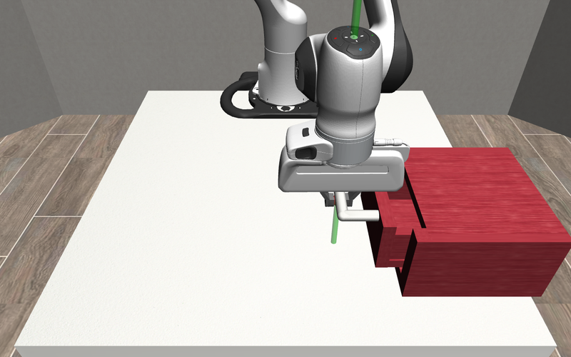

# AICON Tutorial: Opening a Drawer in Simulation

This tutorial builds a complete AICON system step by step: a simulated Panda robot has to find a drawer handle,
grasp it and pull the drawer open. The code it describes is in [`tutorial/`](tutorial); run it with

```bash
python -m examples.drawer_sim.run_experiment --render
```

(`--render` opens the MuJoCo viewer; without it the run is headless and a plot is written to `outputs/drawer_sim/`).



The tutorial is adapted from the drawer tutorial of the first public AICON release by Adrian Pfisterer and Patrick
Lowin.

Opening a drawer is a sequence of subtasks: locate the handle, move to it, grasp it, find out in which direction the
drawer moves, and pull. Planning these subtasks one after another is brittle, because every unexpected change (a
slipping grasp, a wrong estimate) invalidates the plan. In AICON there is no plan. The system consists of
differentiable recursive estimators that are linked by **active interconnections**, and a single goal on one of the
estimates. The gradient of that goal flows backwards through the interconnections to the actions, and which path it
takes depends on the current state: while the drawer is not grasped, moving the end-effector cannot change the
drawer's opening, but grasping it can, so the gradient leads to the handle and to closing the gripper.

There are four kinds of building blocks (see `aicon_base/components`):

| Component | Implements | Here |
|---|---|---|
| `SensorComponent` | `obtain_measurements` | end-effector position, handle position, force at the end-effector |
| `EstimationComponent` | `initialize_quantities`, `define_estimation_function_f` | end-effector, handle, grasp, drawer joint |
| `ActionComponent` | `determine_new_actions`, `send_action_values` | end-effector velocity, gripper |
| `ActiveInterconnection` | `define_implicit_connection_function` | the relations between the quantities above |

and **goals** (`Goal`), costs on the quantities of the estimator they are attached to.

Components never call each other. Every component declares its quantities by name, and components share quantities
through the interconnections they are connected to.

## Our first estimator: the end-effector

To move the robot we command end-effector velocities, so we need an estimate of where the end-effector is. An
`EstimationComponent` declares its quantities and their shapes, initialises them, and defines the function `f` that
updates them every tick ([`tutorial/estimators.py`](tutorial/estimators.py)):

```python
class EEPoseEstimator(EstimationComponent):
    cls_quantity_names_and_shapes = {"pose_ee": (3,), "uncertainty_ee": (3, 3)}

    def initialize_quantities(self):
        c_proprio = self.connections["DirectMeasurement"]
        with c_proprio.lock:
            if not c_proprio.connected_quantities_initialized["ee_pos_meas"]:
                return False
            pose_measured_ee = c_proprio.connected_quantities["ee_pos_meas"]
        self.quantities["pose_ee"] = pose_measured_ee
        self.quantities["uncertainty_ee"] = torch.eye(3, dtype=self.dtype, device=self.device) * 0.001
        return True
```

`initialize_quantities` is called until it returns `True`. It reads the first measurement from the `DirectMeasurement`
interconnection; connections are shared between components, so they are accessed under their lock.

`define_estimation_function_f` returns the update function and the names of its outputs. The argument names of
`f_func` are quantity names (this component's own quantities, those of its connections, and `dt`); the framework
collects them every tick and differentiates the outputs with respect to the inputs:

```python
    def define_estimation_function_f(self):
        c_proprio = self.connections["DirectMeasurement"].c_func
        c_action = self.connections["ForwardKinematics"].c_func

        def f_func(pose_ee, uncertainty_ee, ee_pos_meas, action_velo_ee):
            eye = torch.eye(3, dtype=self.dtype, device=self.device)
            mu_pred, Sigma_pred = predict_ekf_other_quantity(c_action, pose_ee, uncertainty_ee, action_velo_ee,
                                                             torch.zeros(3, 3, dtype=self.dtype, device=self.device),
                                                             eye * 0.01)
            mu_new, Sigma_new = update_ekf(c_proprio, mu_pred, Sigma_pred, ee_pos_meas, eye * 0.01, eye * 0.01)
            Sigma_new = Sigma_new.detach()
            mu_new = mu_new + c_proprio(mu_new, ee_pos_meas).detach()
            return (mu_new, Sigma_new), (mu_new, Sigma_new)

        return f_func, ["pose_ee", "uncertainty_ee"], ["pose_ee", "uncertainty_ee"]
```

This is an extended Kalman filter (`aicon_base.inference.ekf`): the commanded velocity predicts the next position,
the measurement corrects it. The last line sets the estimate exactly to the measurement but keeps the gradient of the
prediction, so the derivative of the estimate with respect to `action_velo_ee` survives. `f_func` returns two tuples:
the outputs to differentiate and all outputs.

> Everything in `f_func` has to be differentiable with `torch.func`: this is how goals become actions.

## The drawer handle

The handle position is estimated from a direct measurement and, while the drawer is grasped, from the end-effector:

```python
        def f_func(position_drawer, uncertainty_drawer, pose_ee, uncertainty_ee, drawer_pos_meas,
                   likelihood_grasped_drawer, dt):
            eye = torch.eye(3, dtype=self.dtype, device=self.device)
            forward_noise = likelihood_grasped_drawer * 0.15 * dt + 0.005 * dt
            mu_new, Sigma_new = predict_ekf(forward_drawer, position_drawer, uncertainty_drawer, eye * forward_noise)
            mu_new, Sigma_new = update_switching_ekf(c_grasped, mu_new, Sigma_new, pose_ee, uncertainty_ee,
                                                     eye * 0.03, likelihood_grasped_drawer,
                                                     outlier_rejection_threshold=0.05,
                                                     prevent_uncertainty_state_grad=False)
            mu_new, Sigma_new = update_ekf(c_direct_meas, mu_new, Sigma_new, drawer_pos_meas, eye * 0.03, eye * 0.03,
                                           prevent_uncertainty_state_grad=False)
            return (mu_new, Sigma_new), (mu_new, Sigma_new)
```

A drawer does not move by itself, so the prediction keeps the position and only grows the uncertainty, more so when
it is grasped. The `update_switching_ekf` applies the end-effector position as a measurement of the handle, weighted
by the likelihood that the drawer is grasped. This switching update is the reason the goal's gradient can reach the
end-effector at all, and also the gripper: its derivative with respect to `likelihood_grasped_drawer` tells the
system how much a grasp would let the end-effector move the drawer.

## The drawer's joint

The goal is about how far the drawer is open, so we estimate its prismatic joint: an axis (azimuth and elevation), the
joint value along it, and the point where the drawer is when closed:
`kinematic_joint = [azimuth, elevation, joint value, initial point (3)]`.

```python
        def f_func(kinematic_joint, uncertainty_joint, position_drawer, uncertainty_drawer, likelihood_grasped_drawer,
                   dt):
            grasped = gradient_preserving_clipping(likelihood_grasped_drawer, 0.000000000001, 1.0)
            not_grasped = gradient_preserving_clipping((0.2 - likelihood_grasped_drawer) / 0.2, 0.0000000001, 1.0)
            shift = torch.diag(torch.cat([grasped, grasped, grasped, not_grasped, not_grasped, not_grasped]))
            ...
            mu_new, Sigma_new = update_shifting_ekf(c_func, mu_new, Sigma_new, position_drawer, uncertainty_drawer,
                                                    R_additive, shift, outlier_rejection_threshold=1.0)
```

The joint does not move by itself either. The `update_shifting_ekf` decides which part of the state the handle
position informs: while the drawer is not grasped, a change of the handle position means that our idea of where the
drawer is was wrong (the initial point); while it is grasped, it means that the drawer moved along its axis (axis and
joint value). `gradient_preserving_clipping` clips values but keeps their gradient.

## The grasp

Whether the drawer is grasped is not measured; it is inferred from the distance between end-effector and handle, the
force at the end-effector and the gripper:

```python
        def f_func(likelihood_grasped_drawer, pose_ee, position_drawer, ee_force_mag_meas, gripper_activation):
            innovation = c_func(likelihood_grasped_drawer, pose_ee, position_drawer, ee_force_mag_meas,
                                gripper_activation)
            new_likelihood = gradient_preserving_clipping(likelihood_grasped_drawer + innovation, 1e-10, 0.9999999)
            return (new_likelihood,), (new_likelihood,)
```

The evidence is accumulated by the `GraspedLikelihood` interconnection described below. This simple model makes many
assumptions; the [extended example](#going-further-a-wrist-camera-and-triangulation) and the real-robot example in
`examples/drawer_manipulation` use more careful ones.

## Sensors

Sensors write measured quantities in `obtain_measurements` ([`tutorial/sensors.py`](tutorial/sensors.py)). In
simulation they read the ground truth from the environment; on a real robot they would read ROS topics (see
`aicon_real_robots/sensors`):

```python
class EEPoseSensor(SimulationSensor):
    cls_quantity_names_and_shapes = {"ee_pos_meas": (3,)}

    def obtain_measurements(self) -> bool:
        self.quantities["ee_pos_meas"] = self.measurement(self.env.env.get_ee_pos())
        return True
```

The handle position (`DrawerPoseSensor`) and the force at the end-effector (`EEForceSensor`) are measured the same
way.

## The goal

The only goal of the system is to bring the drawer's joint value to `OPEN_VALUE` (negative values are open). It is
attached to the joint estimator, whose quantities it can use ([`tutorial/goals.py`](tutorial/goals.py)):

```python
class DrawerOpenViaJointGoal(Goal):
    def define_goal_cost_function(self):
        open_value = torch.tensor(self.open_value, dtype=self.dtype, device=self.device)

        def goal_func(kinematic_joint):
            cost = 10.0 * torch.abs(kinematic_joint[2:3] - open_value)
            return cost, cost

        return goal_func
```

Nothing in the system mentions the handle, the gripper or the grasp as a goal. They become subgoals because they
are on the path of this goal's gradient.

## Active interconnections

An active interconnection is a differentiable relation between quantities of different components
([`tutorial/connections.py`](tutorial/connections.py)). It declares the quantities it relates and an implicit function
that is zero when they are consistent; the estimators use it as a measurement model or a motion model, and the
framework uses it to pass gradients between the components.

The joint and the handle are related by the joint's kinematics: the handle is at the initial point moved by the joint
value along the axis.

```python
class KinematicJointConnection(ActiveInterconnection):
    def __init__(self, name, dtype=None, device=None, mockbuild=False):
        super().__init__(name, {"kinematic_joint": (6,), "uncertainty_joint": (6, 6),
                                "position_drawer": (3,), "uncertainty_drawer": (3, 3),
                                "likelihood_grasped_drawer": (1,)},
                         dtype=dtype, device=device, mockbuild=mockbuild)

    def define_implicit_connection_function(self):
        def connection_func(kinematic_joint, position_drawer):
            azimuth, elevation, state, initial_point = (kinematic_joint[0:1], kinematic_joint[1:2],
                                                        kinematic_joint[2:3], kinematic_joint[3:])
            axis = torch.cat([torch.cos(azimuth) * torch.sin(elevation),
                              torch.sin(azimuth) * torch.sin(elevation),
                              torch.cos(elevation)], dim=0)
            return initial_point + axis * state - position_drawer

        return connection_func
```

A grasped drawer moves with the end-effector, so their positions coincide:

```python
class EEDrawerGraspedConnection(ActiveInterconnection):
    def __init__(self, name, dtype=None, device=None, mockbuild=False):
        super().__init__(name, {"pose_ee": (3,), "uncertainty_ee": (3, 3), "position_drawer": (3,),
                                "uncertainty_drawer": (3, 3), "likelihood_grasped_drawer": (1,)},
                         dtype=dtype, device=device, mockbuild=mockbuild,
                         required_signs_dict={"position_drawer": {"likelihood_grasped_drawer": 1},
                                              "uncertainty_drawer": {"likelihood_grasped_drawer": 1},
                                              "pose_ee": {"likelihood_grasped_drawer": -1}})

    def define_implicit_connection_function(self):
        def connection_func(position_drawer, pose_ee):
            return position_drawer - pose_ee

        return connection_func
```

The `required_signs_dict` constrains the gradients that pass through the grasp likelihood: to move the drawer, the
grasp has to become more likely; to move the end-effector freely, less likely.

The grasp likelihood (`DistGraspHandConnection`) grows with proximity to the handle. Close to the handle, the force at
the end-effector and the closed gripper confirm a grasp. If the gripper is closed but nothing is felt, its gradient
points towards opening the gripper, which a new grasp attempt needs.

The remaining interconnections relate the sensors to the estimators (`EEProprioConnection`,
`DrawerDirectMeasurementConnection`: measurement equals estimate) and the end-effector velocity to the end-effector
(`EEVeloConnection`: the velocity moves the end-effector).

## Actions from gradients

The action components turn the gradient on their quantities into commands ([`tutorial/actions.py`](tutorial/actions.py)).
The end-effector velocity takes a gradient descent step along the steepest gradient on `action_velo_ee` (among those
younger than 2 s) and is limited to 0.3:

```python
class VeloEEAction(SimulatedAction):
    cls_quantity_names_and_shapes = {"action_velo_ee": (3,)}

    def determine_new_actions(self):
        steepest_grad, _, _ = self.get_steepest_gradient("action_velo_ee", time_threshold=self.timestamp - 2.0)
        velocity = gradient_descent(self.gain, self.quantities["action_velo_ee"], steepest_grad[:3])
        if torch.norm(velocity) > self.v_max:
            velocity = velocity / torch.norm(velocity) * self.v_max
        self.quantities["action_velo_ee"] = torch.nan_to_num(velocity)
```

The gripper closes or opens depending on the sign of the steepest gradient on `gripper_activation`. In the simulation
the run loop reads both quantities and passes them to the environment, so `send_action_values` does nothing.

## Putting it together

An experiment specification returns builder functions for all components and connections
([`tutorial/experiment_specifications.py`](tutorial/experiment_specifications.py)). Each component gets the
connections it needs, by name:

```python
"DrawerPosEstimator": lambda mockbuild: DrawerPositionEstimator(
    "DrawerPosEstimator", connections("DrawerDirectMeasurement", "GraspedDrawerKinematics", "DrawerKinematics"),
    device=cpu, dtype=double, mockbuild=mockbuild),
```

The run loop ([`run_experiment.py`](run_experiment.py)) builds the components once and then, at 30 Hz, updates all of
them in the order of the specification and sends the resulting actions to the simulation:

```python
components = build_components(builders)
for step in range(n_steps):
    run_component_sequence(components, torch.tensor(t, dtype=torch.float64))
    velocity = components["EEVelocities"].quantities["action_velo_ee"].cpu().numpy()
    gripper = float(components["GripperAction"].quantities["gripper_activation"].squeeze())
    env.step(np.concatenate([velocity, [2 * gripper - 1]]))
    t += env.control_timestep
```

When you run it, the end-effector moves to the handle, closes the gripper there, and pulls the drawer out until it
reaches the end of its travel (the drawer of the cabinet model has a joint range of 4 cm). The estimated joint
value follows the drawer once the grasp is detected.

## Going further: a wrist camera and triangulation

The [extended example](extended), by James Reynaldo, replaces the direct measurement of the handle by a camera on the
robot's wrist that only measures the **bearing** to the handle, i.e. its direction without depth:

```bash
python -m examples.drawer_sim.run_experiment --variant extended --render
```

A single bearing does not determine the handle's position, so the estimate starts from a depth prior with a large
uncertainty and is refined by bearings from different viewpoints (triangulation) while the robot moves. Additional
estimators make this possible: the end-effector pose is 6D (the camera's orientation matters), a visibility
estimator weights bearing measurements by the likelihood that the handle is in the camera's field of view, and a
distance estimator provides the end-effector-to-handle distance and its uncertainty, which gate the grasp: the robot
only grasps once the handle position is certain enough. With

```bash
python -m examples.drawer_sim.run_experiment --variant extended --no-triangulation
```

the same graph measures the handle position directly instead; `--noise` scales the simulated sensor noise. With
triangulation, the robot grasps later because it first makes the handle position certain: `--depth-prior-noise 0.1`
starts from a depth guess that is off by up to about 10 cm, which the bearings from the first few seconds of motion
correct to a few millimetres.
